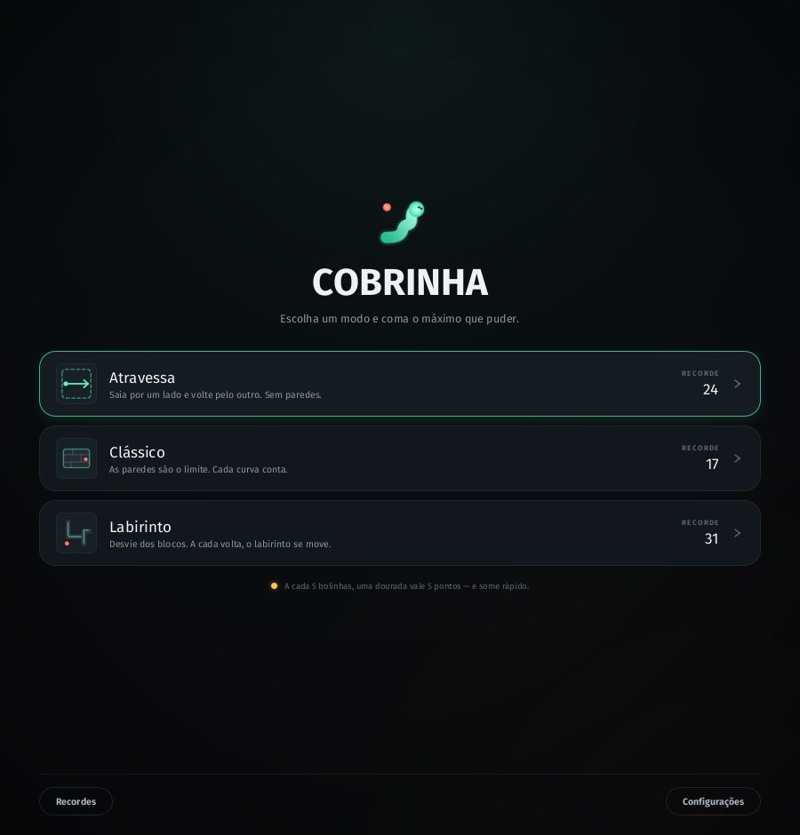
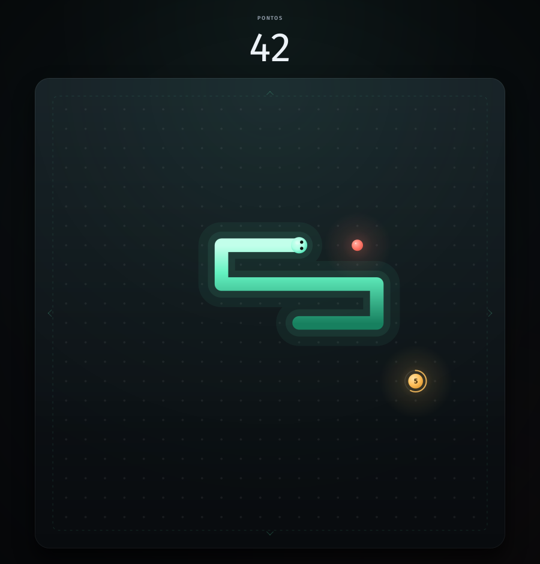
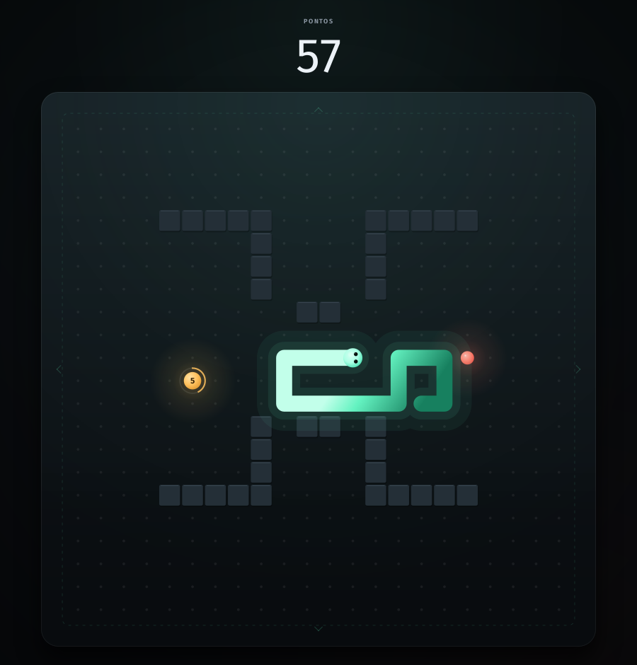
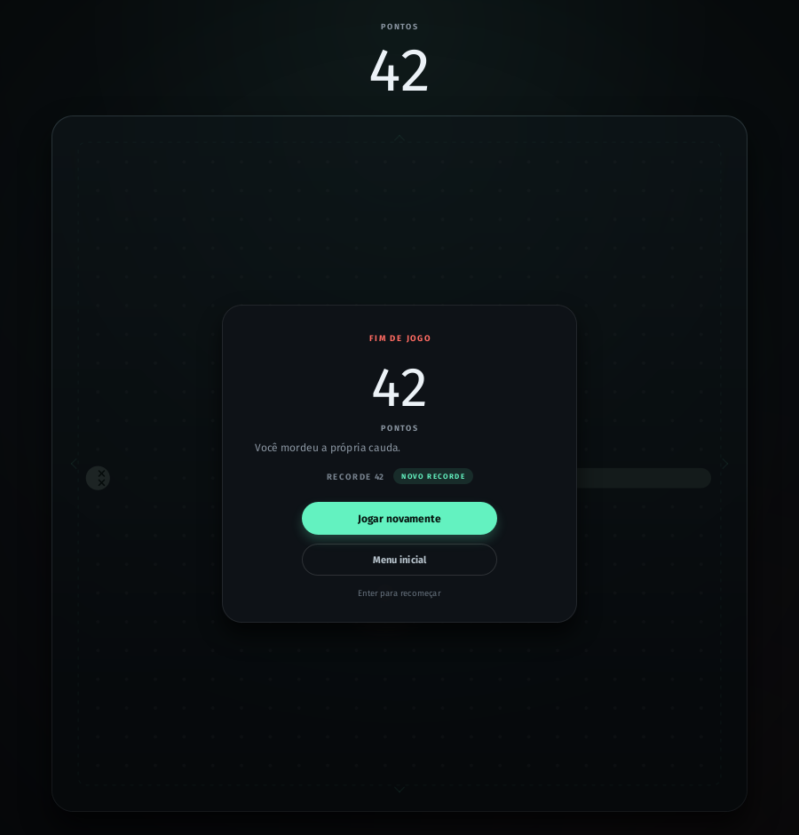
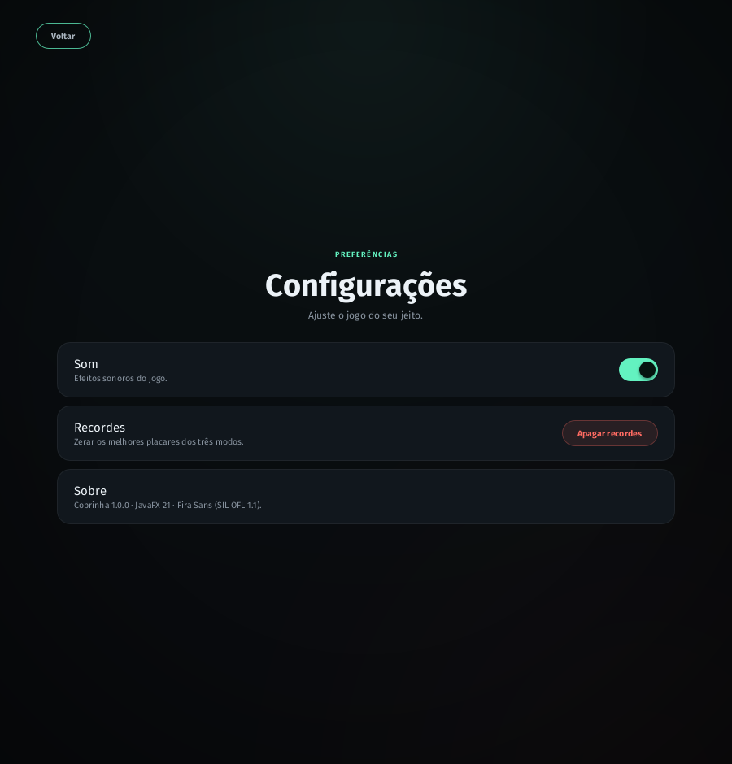
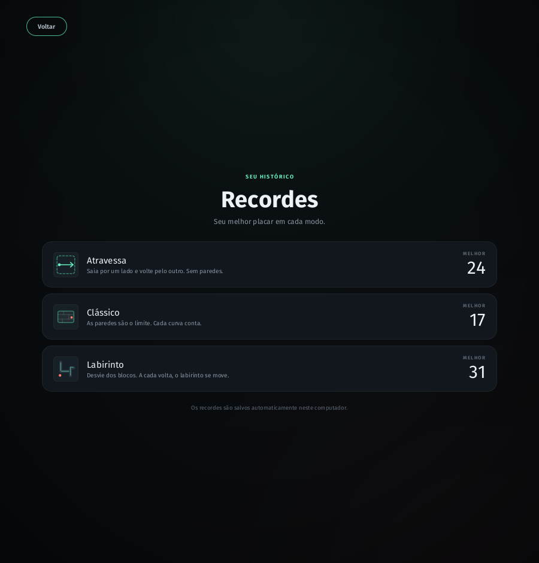

# Cobrinha

Jogo da cobrinha com visual minimalista, desenvolvido em **Java 21** com **JavaFX**.
Três modos de jogo, efeitos sonoros sintetizados, recordes persistentes e uma
interface pensada para ser jogada inteiramente pelo teclado.



---

## Sumário

- [Recursos](#recursos)
- [Modos de jogo](#modos-de-jogo)
- [Regras do jogo](#regras-do-jogo)
- [Controles](#controles)
- [Configurações e recordes](#configurações-e-recordes)
- [Requisitos](#requisitos)
- [Como executar](#como-executar)
- [Testes](#testes)
- [Estrutura do projeto](#estrutura-do-projeto)
- [Onde os dados são salvos](#onde-os-dados-são-salvos)
- [Créditos e licença](#créditos-e-licença)

---

## Recursos

- **Três modos de jogo** inspirados no clássico, cada um com comportamento próprio.
- **Fruta dourada**: a cada 5 bolinhas comidas aparece uma fruta especial com
  tempo limitado.
- **Dificuldade progressiva**: a cobra acelera conforme você come.
- **Curvas em buffer**: até duas viradas na fila, com bloqueio de meia-volta
  (você nunca dobra 180° por acidente).
- **Efeitos sonoros sintetizados em tempo real** — nenhum arquivo de áudio é
  embutido no projeto.
- **Recordes persistentes** por modo, salvos automaticamente.
- **Navegação 100% por teclado**, com atalhos para todos os atalhos principais.
- **Visual responsivo**: o tabuleiro se adapta ao tamanho da janela e mantém a
  proporção quadrada.

---

## Modos de jogo

| Modo       | Atalho | Comportamento                                                        |
|------------|:------:|----------------------------------------------------------------------|
| Atravessa  |  `1`   | As bordas são livres: a cobra sai por um lado e volta pelo outro.    |
| Clássico   |  `2`   | As paredes matam. Cada curva precisa ser planejada.                  |
| Labirinto  |  `3`   | Atravessa as bordas, mas há blocos no caminho que **mudam de lugar a cada volta**. |




---

## Regras do jogo

- O tabuleiro tem, por padrão, **22×22** células.
- A cobra começa com **4 segmentos** e se move para a direita.
- Cada **bolinha** vale **1 ponto**.
- A cada **5 bolinhas** comidas, surge uma **fruta dourada** que vale
  **5 pontos** e desaparece após **9 segundos** (um anel mostra o tempo restante).
- A cada bolinha, o intervalo entre passos diminui (de 150 ms até 72 ms),
  tornando o jogo mais rápido.
- O jogo termina quando:
  - a cobra bate em uma parede (no modo Clássico);
  - a cobra bate em si mesma (em qualquer modo);
  - a cobra bate num bloco do labirinto (no modo Labirinto).
- Você **vence** quando não sobra nenhuma célula livre no tabuleiro.



---

## Controles

### Durante o jogo

| Tecla            | Ação                                     |
|------------------|------------------------------------------|
| `↑` `↓` `←` `→`  | Mudar a direção                          |
| `W` `A` `S` `D`  | Mudar a direção (alternativa)            |
| `Espaço`         | Iniciar / pausar / retomar               |
| `Enter`          | Recomeçar / retomar                      |
| `Esc`            | Pausar / retomar; no fim, volta ao menu  |
| `R`              | Reiniciar a partida                      |
| `M`              | Alternar o som (mudo / com som)          |

### No menu inicial

| Tecla                 | Ação                          |
|-----------------------|-------------------------------|
| `1` `2` `3` (e numpad)  | Escolher o modo diretamente |
| `Enter` / `Espaço`    | Ativar o modo em foco        |
| `Enter`               | Ativa os botões               |

### Em geral

- `Esc` ou `Backspace` voltam para a tela anterior (por exemplo, nos recordes).
- Se a janela perder o foco durante uma partida, o jogo **pausa automaticamente**.

---

## Configurações e recordes

A tela de **Configurações** permite:

- **Som**: ativar ou desativar os efeitos sonoros.
- **Recordes**: apagar os melhores placares dos três modos (com confirmação).



A tela de **Recordes** mostra o melhor placar de cada modo. Os recordes são
salvos automaticamente assim que um novo é alcançado.



---

## Requisitos

- **JDK 21** (ou superior)
- **Maven 3.9+**

> No Ubuntu/Pop!_OS, instale com:
> ```bash
> sudo apt install openjdk-21-jdk maven
> ```

O `run.sh` também sabe aproveitar um toolchain portátil localizado em `.tools/`
(Java 21 + Maven), útil para ambientes de desenvolvimento sem JDK instalado.

---

## Como executar

Na raiz do projeto, use uma das opções:

```bash
# Atalho recomendado (escolhe automaticamente o toolchain disponível)
./run.sh

# Ou diretamente com Maven
mvn javafx:run
```

> O perfil Maven `ecj` permite compilar com o Eclipse Compiler em ambientes
> onde não há `javac` (ex.: um JRE puro):
> ```bash
> mvn -Pecj javafx:run
> ```

---

## Testes

O motor do jogo é totalmente coberto por testes de unidade (JUnit 5), que não
dependem de interface gráfica:

```bash
mvn test
```

---

## Estrutura do projeto

```
src/main/java/com/cobrinha/
├── CobrinhaApp.java        # Ponto de entrada e navegação entre telas
├── audio/
│   └── Sound.java          # Efeitos sonoros sintetizados (sem arquivos de áudio)
├── core/                   # Motor do jogo, sem dependência de JavaFX
│   ├── Cell.java
│   ├── Direction.java
│   ├── GameMode.java
│   ├── GameState.java
│   ├── PlayerProfile.java
│   ├── ProfileStore.java
│   ├── SnakeGame.java
│   └── TickResult.java
└── ui/                     # Telas e renderização (JavaFX)
    ├── HomeScreen.java
    ├── GameScreen.java
    ├── BoardView.java
    ├── RecordsScreen.java
    ├── SettingsScreen.java
    └── ...
src/main/resources/
├── css/                    # Estilos da interface
├── fonts/                  # Fira Sans (SIL OFL 1.1)
└── icons/                  # Ícone do jogo e marca
src/test/java/              # Testes do motor
```

A separação é intencional: o pacote `core` não conhece JavaFX, o que permite
testar toda a lógica do jogo isoladamente.

---

## Onde os dados são salvos

O perfil (recordes e preferência de som) é gravado em
`~/.config/cobrinha/config.properties` (respeitando a variável `XDG_CONFIG_HOME`
no Linux).

Para apontar o jogo para outro diretório durante desenvolvimento ou captura de
telas, defina a propriedade de sistema:

```bash
mvn javafx:run -Djavafx.args="-Dcobrinha.config.dir=/tmp/cobrinha"
```

---

## Créditos e licença

- **Fonte:** Fira Sans, distribuída sob a licença SIL Open Font License 1.1.
- **Código:** MIT — veja [LICENSE](LICENSE).
